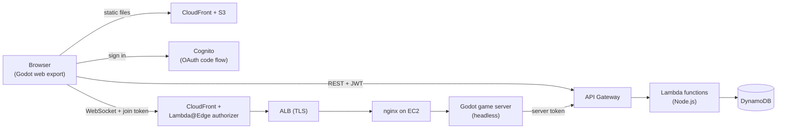

# Poker

A multiplayer Texas Hold'em game that runs in the browser. Friends sign in, create or join a
table, and play in real time; the game tracks who owes whom when the table closes.

Everything here was written by hand, without AI-generated code: the Godot client and game
server, the serverless API, and the AWS infrastructure.

## How it fits together



- **Client:** Godot 4.5, exported to the web.
- **Game server:** the same Godot project, exported as a headless Linux server. nginx routes each
  table's WebSocket connection to its own server process (`/game/<port>`).
- **API:** one Lambda per operation (accounts, friends, games, join tokens, ledgers, debts)
  behind API Gateway.
- **Data:** DynamoDB tables for accounts, friends, games, join tokens, game ledgers and debts.
- **Contracts:** `shared/poker_api.proto` defines every record and response, used by the
  Lambdas (protobufjs) and the Godot client (generated GDScript).
- **Infrastructure:** all of it in Terraform (`terraform/`).

## Security

- **Signing in:** Cognito with the OAuth authorization code flow, a strong password policy and
  60-minute access tokens. The API Gateway JWT authorizer checks issuer and audience on every
  request; CORS allows only the game's own origins.
- **Joining a table:** the `JoinGame` Lambda checks the table's privacy (public, friends-only,
  private) and issues a single-use join token tied to that account and table.
- **Connecting to a game server:** a Lambda@Edge authorizer runs before any WebSocket reaches
  the server. It verifies the Cognito JWT itself (issuer, audience, expiry, and the RS256
  signature against Cognito's published keys), checks the join token belongs to this account
  and table, and checks the table is active. Only then does the request continue, carrying a
  verified account ID.
- **Server authority:** the game server shuffles, deals and scores. Client RPCs are checked
  against the sender's connection and the current phase of the hand.
- **Network:** only the load balancer can reach the EC2 instance, and nginx rejects requests
  without a private token the ALB adds. The game server calls the API with its own token,
  checked by a separate authorizer. CloudFront adds HSTS, `nosniff` and frame-options headers.
- **Secrets and permissions:** tokens are generated by Terraform and kept in SSM Parameter
  Store as SecureStrings. Each IAM role gets only the tables, parameters and buckets it uses.

## Repository layout

| Path | What's there |
| --- | --- |
| `scenes/`, `scripts/` | Godot client and game server (managers, UI, networking, contracts) |
| `scripts/tests/` | Hand-ranking tests |
| `src/functions/` | Lambda functions, one folder each |
| `shared/` | Protobuf contract and helpers shared by the Lambdas |
| `terraform/` | All AWS infrastructure |
| `powershell/`, `aws/` | Export, staging and deploy scripts |
| `Justfile` | Shortcuts for the scripts above |

## Running and deploying

Requirements: Godot 4.5, Node.js, Terraform, PowerShell 7, [just](https://github.com/casey/just),
and the AWS CLI configured with `aws configure`.

```bash
just                       # list every command
just generate-proto        # regenerate GDScript from shared/poker_api.proto
just plan-terraform        # stage the Lambdas and preview infrastructure changes
just full-deploy dev       # Lambdas, web client, game server and infrastructure
just shutdown-server dev   # stop the EC2 game server to save money
```

`powershell/start_server_and_client.ps1` runs a server and client locally for development.

